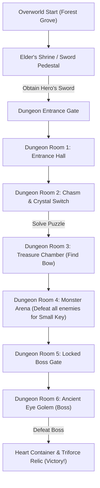

# Game Design Specification: 16-Bit Zelda-Like Web Adventure

Inspired by the Google [Antigravity Arcade](https://developers.google.com/solutions/learn/antigravity-arcade) tutorial, this document establishes the full architecture, mechanics, asset pipeline, and deployment strategy for the web game.

---

## 1. Executive Summary & Design Matrix

| Component | Selected Strategy | Rationale |
| :--- | :--- | :--- |
| **Tech Stack** | **Phaser 3 + TypeScript + Vite** | Robust 2D arcade physics, tilemap support, fast HMR dev loop, zero-hassle static production bundles. |
| **Visual Style** | **16-Bit Retro Pixel Art (16x16)** | Curated CC0 tilesets and sprite sheets (Kenney / OpenGameArt) providing an authentic SNES / Game Boy Color aesthetic. |
| **World Scope** | **Compact Overworld + 1 Dungeon** | An introductory forest/village surface area transitioning into a 6-room puzzle/combat dungeon with a boss chamber. |
| **Hero Combat** | **Sword, Shield & Bow & Arrows** | 4-directional melee slash with knockback, passive frontal shield block, ranged bow attacks, and heart health. |
| **Dungeon Mechanics**| **Crystal Switches, Keys & Puzzles** | Pits/chasms requiring arrow shots to trigger switches, locked doors with small keys, and pushable blocks. |
| **Boss Encounter** | **Ancient Eye Golem (Gohma-style)**| Projectile attack phases, eye-opening tell; shoot eye with arrow to stun, follow up with sword combo. |
| **Audio Engine** | **Procedural Web Audio (ZzFX)** | Zero-latency, zero-asset-download 8-bit retro sound effects (slashes, bow shots, hits, secret chime, victory fanfare). |
| **Input Controls** | **Desktop Keyboard Only** | Clean, minimalist interface optimized for desktop browser play without on-screen mobile overlays. |
| **Persistence** | **LocalStorage Auto-Save** | Automatic checkpoint saves at key milestones (sword pickup, dungeon entry, chests, keys) and room respawn on death. |
| **Deployment** | **Firebase Hosting** | Direct alignment with Google Antigravity Arcade; includes `firebase.json`, `.firebaserc`, and npm deploy scripts. |

---

## 2. World Layout & Progression Flow



### Overworld (Surface Area)
- **Starting Area**: Lush forest glade with grass, trees, and stone pathways.
- **Objectives**:
  1. Learn movement controls.
  2. Interact with the shrine / pedestal to pull the **Hero's Sword**.
  3. Clear bushes / test attacks on slime enemies blocking the dungeon path.
  4. Enter the dark stone dungeon stairway.

### Dungeon (The Sunken Crypt - 6 Rooms)
1. **Entrance Foyer**: Introduction to dungeon atmosphere, torch lighting, closed door opening when stepping on floor switch.
2. **Crystal Chasm**: A deep pit separates the player from a locked door. A crystal switch sits on the far ledge. Requires the Bow to trigger!
3. **Treasure Chamber**: Guarded by skeleton enemies. Defeating them unlocks the golden chest containing the **Bow & Quiver**.
4. **Combat Arena**: Fast-moving bats and armored skeletons. Defeating all enemies drops the **Dungeon Key**.
5. **Pre-Boss Chamber**: Puzzle room with a locked door, requiring the key and a timed switch combination.
6. **Boss Sanctum**: High-stakes arena housing the **Ancient Eye Golem**.

---

## 3. Combat & Player Systems

### Input Mapping (Desktop Keyboard)
- **Move**: `W, A, S, D` or `Arrow Keys` (4-directional / 8-directional movement)
- **Primary Attack (Sword)**: `Space` or `Z`
- **Secondary Weapon (Bow)**: `X`
- **Interact / Dialogue**: `Enter` or `E`
- **Pause / Status**: `Escape` or `P`

### Combat Parameters
- **Health**: 3 full hearts (6 half-heart units). Hearts drop from defeated foes or cut bushes.
- **Invulnerability**: 1.0 second of flashing invulnerability upon taking damage.
- **Knockback**: Both player and enemies suffer physical knockback upon sword collision.
- **Shield**: Passive defense against enemy projectiles when facing the incoming missile.
- **Bow**: Shoots arrows in the current facing direction. Consumes arrow ammo or uses standard recharge meter.

---

## 4. Boss Encounter: Ancient Eye Golem

- **Phase 1 (Stalking & Projectiles)**:
  - The Golem stomps between waypoints, periodically firing energy rings or rock bursts.
  - Its eye is closed and armored; sword strikes bounce off harmlessly.
- **Phase 2 (The Tell & Arrow Stun)**:
  - The Golem pauses and its eye turns bright red to charge a laser.
  - **Vulnerability Window**: The player must loose an arrow into the open eye.
  - **Stunned State**: Golem drops to its knees for 3.5 seconds, shaking.
- **Phase 3 (Melee Rush)**:
  - The player closes in and executes sword slashes.
  - After taking damage or when the timer expires, the Golem roars with knockback and resumes Phase 1 with increased speed.
- **Victory**:
  - Golem shatters into glowing particles.
  - Spawns a **Heart Container** (increases max health to 4 hearts) and the **Ancient Relic**.
  - Triggers the victory fanfare and end-game screen.

---

## 5. Technical Architecture

```
/home/ricardo/game/
├── package.json               # Vite + Phaser 3 + TypeScript
├── tsconfig.json              # Strict TS configuration
├── vite.config.ts             # Fast bundling with asset handling
├── firebase.json              # Firebase Hosting configuration
├── .firebaserc                # Firebase project settings
├── index.html                 # HTML entry point with retro arcade viewport
├── public/
│   ├── assets/                # 16x16 pixel tilesets and sprites
│   └── favicon.ico
└── src/
    ├── main.ts                # Phaser game configuration & bootstrapping
    ├── scenes/
    │   ├── BootScene.ts       # Asset preloading & sound engine init
    │   ├── TitleScene.ts      # Retro arcade title screen (New Game / Continue)
    │   ├── OverworldScene.ts  # Surface forest / shrine area
    │   ├── DungeonScene.ts    # Multi-room dungeon exploration
    │   ├── BossScene.ts       # Final boss chamber
    │   ├── UIScene.ts         # Hearts, keys, inventory HUD overlay
    │   └── VictoryScene.ts    # Win screen & game stats
    ├── entities/
    │   ├── Player.ts          # Hero movement, sword hitbox, shield, bow
    │   ├── Enemy.ts           # Base enemy class with AI states & knockback
    │   ├── Slime.ts           # Overworld bouncing enemy
    │   ├── Bat.ts             # Erratic flying dungeon enemy
    │   ├── Skeleton.ts        # Patrolling melee dungeon enemy
    │   └── BossGolem.ts       # Ancient Eye Golem boss AI
    ├── systems/
    │   ├── AudioSystem.ts     # ZzFX procedural Web Audio retro sound generator
    │   ├── SaveSystem.ts      # LocalStorage checkpoint & progress manager
    │   └── CombatSystem.ts    # Damage, collision, and knockback resolution
    └── types/
        └── game.d.ts          # Game interfaces & definitions
```

---

## 6. Deployment Pipeline (Firebase Hosting)

In accordance with the Google Antigravity Arcade guide:
1. Build production bundle: `npm run build` -> outputs optimized static files to `dist/`.
2. `firebase.json` maps `dist/` as the public directory with single-page-app rewrite rules and caching headers.
3. Deploy to Firebase using `firebase deploy --only hosting`.
