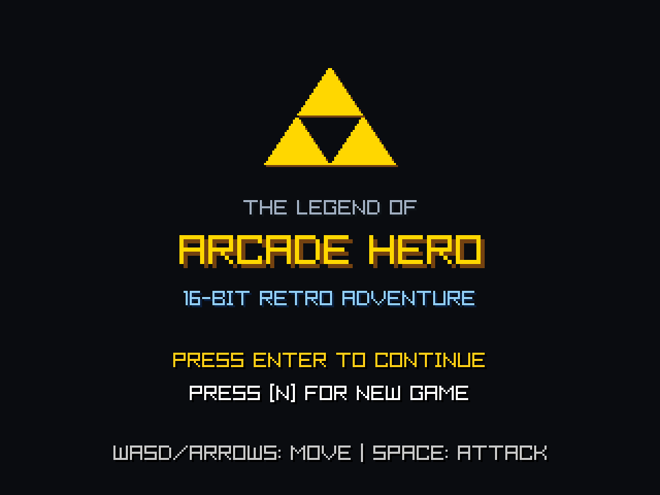
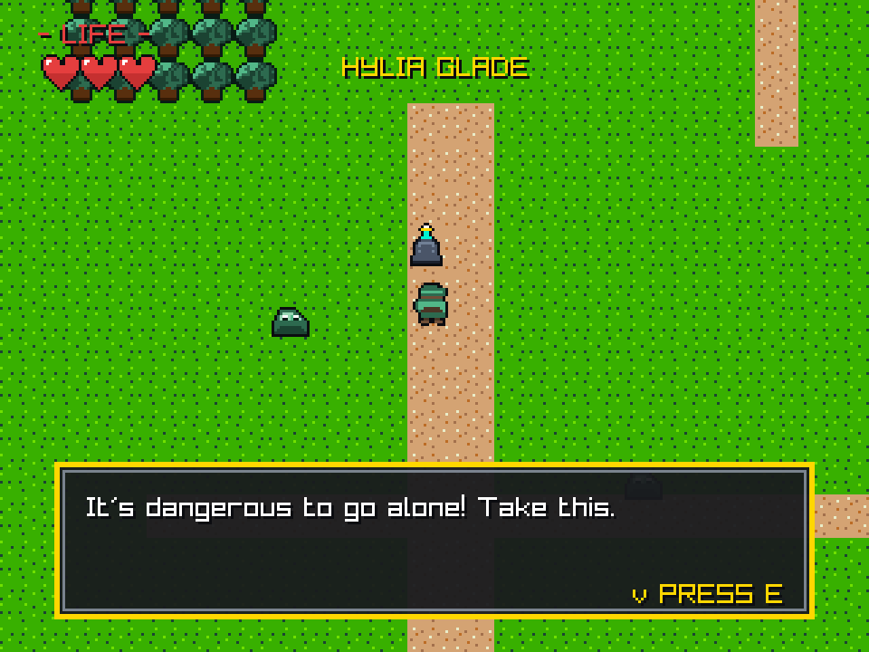
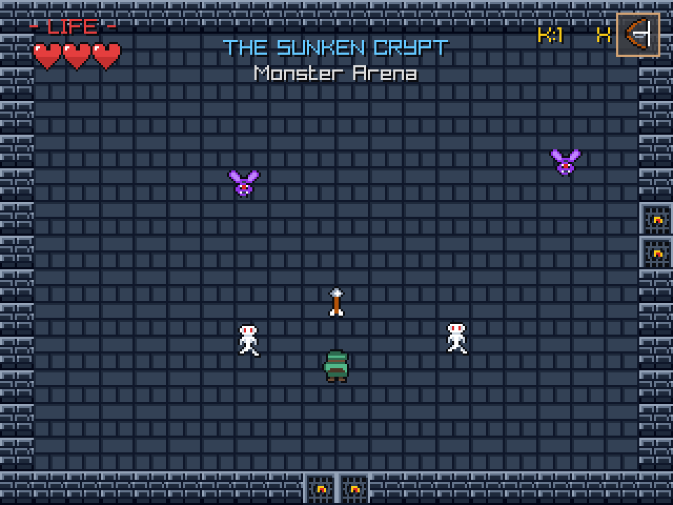
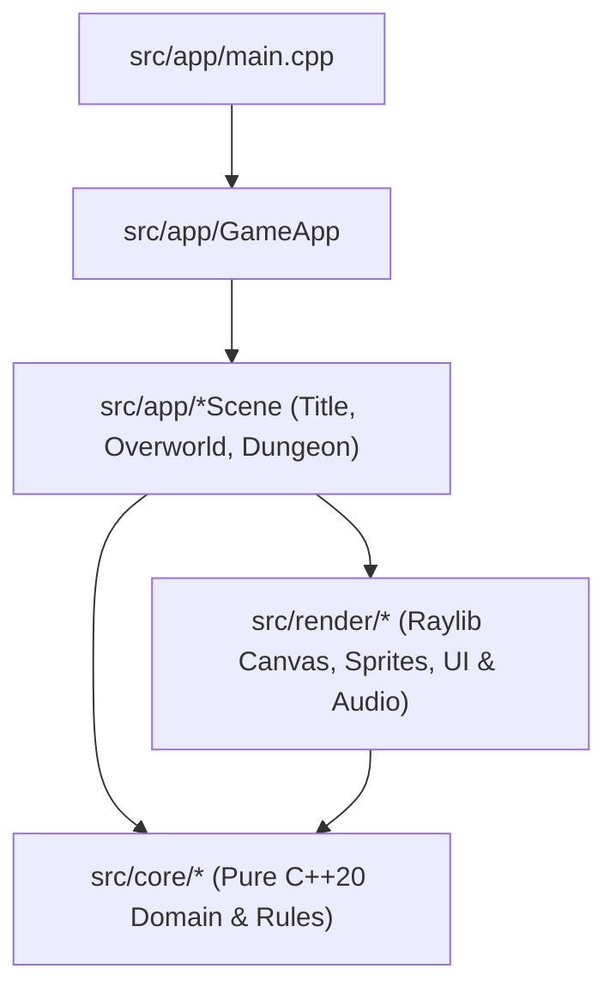
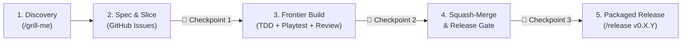

# The Legend of Arcade Hero

[](https://github.com/ricard0mat0s/zelda/releases)
[](Makefile)
[](vendor/raylib)
[](AGENT.md)

**The Legend of Arcade Hero** is a native **C++20 + Raylib** 16-bit-style action-adventure game—and a practical reference showcase for **Agentic Software Engineering**.

Every sprite (`16×16` pixel art) and sound effect (`8-bit` PCM WAV) is procedurally generated in C++, the core domain (`src/core/`) is decoupled from rendering for fast headless unit testing (`bin/test_runner`), and gameplay is verified end-to-end through a deterministic headless playtest & screenshot harness (`tools/playtest.py`).

---

## Screenshots

| Retro Title Screen | Hylia Glade & Elder Shrine | The Sunken Crypt Dungeon |
| :---: | :---: | :---: |
|  |  |  |
| *Animated 320×240 virtual canvas upscaled to 960×720* | *Overworld exploration, slimes & typewriter dialogue* | *Multi-room dungeon, bow combat & arena locks* |

---

## Quickstart & Installation

### Option A: Download Prebuilt Linux Release (`v0.1.0+`)

Download the latest self-contained Linux `x86_64` tarball from [GitHub Releases](https://github.com/ricard0mat0s/zelda/releases):

```bash
curl -LO https://github.com/ricard0mat0s/zelda/releases/download/v0.1.0/zelda_game-v0.1.0-linux-x86_64.tar.gz
tar -xzf zelda_game-v0.1.0-linux-x86_64.tar.gz
cd zelda_game-v0.1.0-linux-x86_64
./bin/zelda_game
```

### Option B: Build from Source

The repository vendors a static Linux build of Raylib (`vendor/raylib/lib/libraylib.a`) for hermetic compilation.

**Prerequisites (Linux):**
- `g++` with C++20 support (`-std=c++20`)
- Standard X11 / OpenGL system libraries (`-lGL -lm -lpthread -ldl -lrt -lX11`)

```bash
# 1. Run the headless C++20 domain & asset unit test suite
make test

# 2. Build the game binary (bin/zelda_game)
make

# 3. Launch the game
make run
```

---

## Gameplay Features

- **Procedural 16×16 Pixel Art & 8-Bit Audio Synthesis**: Runtime sprite generation (`GeneratedAssets`) and multi-waveform retro audio synthesis (`SoundGenerator`) with zero external asset pack dependencies.
- **Overworld Exploration (*Hylia Glade*)**: `40×30` tilemap with 4-directional movement, corner-sliding collision physics, smooth camera tracking, and bouncing overworld slimes.
- **Sword, Shield & Bow Combat**:
  - **Ancient Sword**: 4-directional melee slash arc with knockback.
  - **Passive Frontal Shield**: Automatically blocks incoming projectiles and frontal slime contact when not swinging your sword.
  - **Hero's Bow & Quiver**: Long-range arrow projectiles capable of striking enemies and distant crystal switches across chasms.
- **Multi-Room Dungeon (*The Sunken Crypt*)**: 6 interconnected chambers featuring smooth room-panning camera transitions, pressure plates, chasm crystal switches, locked doors, a Monster Arena ambush, and a 3-phase boss encounter (**Ancient Eye Golem**).
- **Automatic JSON Checkpoints**: Persistent `savegame.json` state tracking inventory, dungeon switches/chests, arena clears, and room-entrance respawn.

---

## Controls

### Player Controls

| Action | Primary Key | Alternate Key | Notes |
| :--- | :--- | :--- | :--- |
| **Move** | `W` `A` `S` `D` | `Arrow Keys` | 4-directional movement with corner sliding |
| **Confirm / Start / Continue** | `Space` | `Enter` | Starts or continues from Title Screen; retries on Game Over |
| **New Game (Title Screen)** | `N` | — | Clears save state and starts a fresh quest |
| **Interact / Advance Dialogue** | `E` | `Enter` | Inspects Elder Shrine pedestal, opens chests, advances text |
| **Sword Attack** | `Space` | `Z` | 4-directional melee slash (once Sword is acquired) |
| **Fire Bow** | `X` | — | Fires an arrow in the facing direction (once Bow is acquired) |
| **Passive Shield Block** | *(Automatic)* | — | Face incoming projectiles or slimes while idle/walking |
| **Return to Title Screen** | `Backspace` | — | Resets to the Title Screen from Overworld or Dungeon |

### Developer / Debug Hotkeys

| Action | Key | Notes |
| :--- | :--- | :--- |
| **Debug Damage** | `H` | Inflicts 1 half-heart of damage (respects invulnerability frames) |
| **Debug Heal** | `J` | Restores 1 half-heart of health |

---

## Full Quest & Boss Walkthrough

<details>
<summary><strong>Click to expand the complete step-by-step walkthrough (Spoilers)</strong></summary>

1. **Claim the Ancient Sword (*Hylia Glade*)**:
   - From the Overworld spawn `(200, 280)`, walk north along the dirt path to the **Elder Shrine pedestal** at `(200, 180)`.
   - Face `Up` and press `E` (`Enter`) to read the inscription and claim the **Ancient Sword**.
2. **Enter The Sunken Crypt**:
   - Follow the path north-east past the overworld slimes to the **Northern Ruins entrance** at `(320, 32)` and walk into the doorway.
3. **Room 1 — Entrance Foyer**:
   - Step onto the central **pressure plate** at `(160, 112)` to unseal the northern door, then walk north into Room 2.
4. **Room 2 — Crystal Chasm (First Visit)**:
   - A wide chasm blocks the northern passage. Head through the **western door** `(16, 112)` into Room 3.
5. **Room 3 — Treasure Chamber**:
   - Approach the treasure chest at `(160, 96)` facing `Up` and press `E` to claim the **Hero's Bow**. Return east to Room 2.
6. **Room 2 — Crystal Chasm (Puzzle Solution)**:
   - Stand south of the chasm around `(152, 120)` facing `Up` and press `X` to shoot an arrow across the gap into the **Crystal Switch** `(160, 48)`. The northern door unlocks—head north into Room 4.
7. **Room 4 — Monster Arena**:
   - The doors lock behind you. Defeat all **2 Bats** and **2 Skeletons** using your Sword (`Space`/`Z`) or Bow (`X`).
   - Collect the **Small Key** (`K:1`) that spawns in the center `(152, 112)` and exit through the eastern door into Room 5.
8. **Room 5 — Boss Gate Chamber**:
   - Walk up to the locked northern Boss Gate `(152, 24)` with your Small Key to unlock it and enter Room 6.
9. **Room 6 — Boss Sanctum (*Ancient Eye Golem*)**:
   - **Phase 1 (`ArmoredStomp`)**: The Golem is impervious to damage while armored and fires radial rock projectiles—keep moving or block frontal rocks with your passive shield.
   - **Phase 2 (`EyeCharging`)**: When the Golem pauses and opens its glowing eye, fire an **arrow (`X`)** into its eye to stun it.
   - **Phase 3 (`Stunned`)**: Rush in and strike the stunned Golem with your **Sword (`Space`/`Z`)**.
   - Repeat until its 12 HP bar is depleted, then collect the **Heart Container & Triforce Relic** at `(152, 104)` to complete the game!

</details>

---

## Architecture Overview

The codebase enforces a strict one-way dependency boundary separating **Scene Orchestration (`src/app`)**, **Pure Gameplay Domain (`src/core`)**, and **Raylib Presentation Adapters (`src/render`)**:



- **`src/core/` (Zero Raylib Window Coupling)**: Deterministic math, movement/collision (`Movement`, `MapData`), player/combat (`Player`, `Combat`, `Shield`, `Projectile`), dungeon state machine (`Dungeon`, `DungeonEnemies`, `BossGolem`), JSON persistence (`SaveSystem`), and procedural PCM audio synthesis (`SoundGenerator`). Compiled directly into `bin/test_runner` (alongside `src/render/GeneratedAssets.cpp` for procedural pixel-buffer assertions).
- **`src/render/` (Thin Raylib Adapters)**: Fixed `320×240` `VirtualCanvas` integer-scaled to `960×720`, runtime procedural texture generation (`GeneratedAssets`, `AssetManager`), `MapRenderer`, `UIRenderer`, `DialogueBox`, and `AudioPlayer`.
- **`src/app/` (Integration Roots)**: `GameApp` and scene controllers (`TitleScene`, `OverworldScene`, `DungeonScene`) wiring keyboard/harness input to domain models and renderers.

For the full module breakdown and state diagrams, see [`docs/ARCHITECTURE.md`](docs/ARCHITECTURE.md).

---

## Agentic Software Engineering Showcase

Beyond being a playable retro adventure, this repository is built and maintained as an **Agentic Software Engineering** learning environment and reference pipeline (see [`AGENT.md`](AGENT.md)).

### 1. The 5-Stage Agentic Delivery Pipeline

Every feature and bugfix moves through a deterministic 5-stage workflow combining autonomous inner-loop execution with explicit **Human-in-the-Loop Checkpoints**:



### 2. Ground-Truth Verification: Headless TDD & Visual Playtest Harness

Agents verify their own changes using two complementary feedback loops:

1. **Fast Domain Unit Tests (`make test`)**:
   Executes 29+ deterministic unit test suites in `bin/test_runner` covering collision physics, combat arcs, shield blocking, dungeon room graphs, boss phases, and JSON save serialization in milliseconds.
2. **Deterministic Visual & State Playtesting (`tools/playtest.py`)**:
   Runs `bin/zelda_game --harness-file <script>` in a hidden Raylib window (`FLAG_WINDOW_HIDDEN`) to script gameplay sequences, assert against live JSON game state (`.scratch/playtest/state.json`), and capture frame-accurate `960×720` PNG screenshots (`.scratch/playtest/latest.png`):

```bash
# Initialize a headless playtest session on a fresh Overworld save
python3 tools/playtest.py init --new-game

# Walk to the Elder Shrine, face up, and trigger the sword pickup dialogue
python3 tools/playtest.py step "move_to 192 192; face up; interact 110"

# Teleport into the Dungeon Monster Arena with full equipment and fire an arrow
python3 tools/playtest.py step "dismiss_dialogue; give_sword; give_bow; enter_dungeon; room 4; move_to 152 164; face up; bow 5"
```

### 3. Core Reading Curriculum

Every engineering stage in this repository is grounded in foundational software and agentic engineering literature:

| Workflow Stage | Core Concept | Primary Reference |
| :--- | :--- | :--- |
| **System Rules & Skills** | Context Engineering & Progressive Disclosure | Birgitta Böckeler, [*Context Engineering for Coding Agents*](https://martinfowler.com/articles/exploring-gen-ai/context-engineering-coding-agents.html) (MartinFowler.com, 2025); [*AGENTS.md Specification*](https://agents.md/) |
| **Agent Architecture** | Autonomous Loops, Ground-Truth Feedback & Stopping Checkpoints | Erik Schluntz & Barry Zhang, [*Building Effective Agents*](https://www.anthropic.com/research/building-effective-agents) (Anthropic Research, 2024) |
| **Discovery & Seams** | Deep Modules, Information Hiding & Architectural Seams | John Ousterhout, *A Philosophy of Software Design* (2nd ed., 2021); Michael Feathers, *Working Effectively with Legacy Code* (2004) |
| **Domain Modeling** | Ubiquitous Language & Architecture Decision Records (ADRs) | Eric Evans, *Domain-Driven Design* (2003); Michael Nygard, [*Documenting Architecture Decisions*](https://cognitect.com/blog/2011/11/15/documenting-architecture-decisions) (2011) |
| **Spec & Slicing** | Tracer Bullets & Vertical Slices | Andrew Hunt & David Thomas, *The Pragmatic Programmer* (20th Anniversary ed., 2019 — "Tracer Bullets") |
| **TDD & Verification** | Red-Green-Refactor at Domain Seams | Kent Beck, *Test-Driven Development: By Example* (2002) |
| **Commits & Versioning** | Conventional Commits & Semantic Versioning (`0.y.z`) | [*Conventional Commits v1.0.0*](https://www.conventionalcommits.org/en/v1.0.0/); Tom Preston-Werner, [*Semantic Versioning 2.0.0*](https://semver.org/) |
| **Release & Delivery** | Changelogs, Reproducible Releases & DORA Metrics | Olivier Lacan, [*Keep a Changelog 1.1.0*](https://keepachangelog.com/en/1.1.0/); Jez Humble & David Farley, *Continuous Delivery* (2010); Forsgren et al., [*Accelerate / DORA*](https://dora.dev/guides/dora-metrics-four-keys/) |

---

## Repository Links

- **Agent Guidelines & Workflow**: [`AGENT.md`](AGENT.md)
- **Architecture Documentation**: [`docs/ARCHITECTURE.md`](docs/ARCHITECTURE.md)
- **Release History**: [`CHANGELOG.md`](CHANGELOG.md)
- **Issue Tracker & PR Conventions**: [`docs/agents/issue-tracker.md`](docs/agents/issue-tracker.md)
