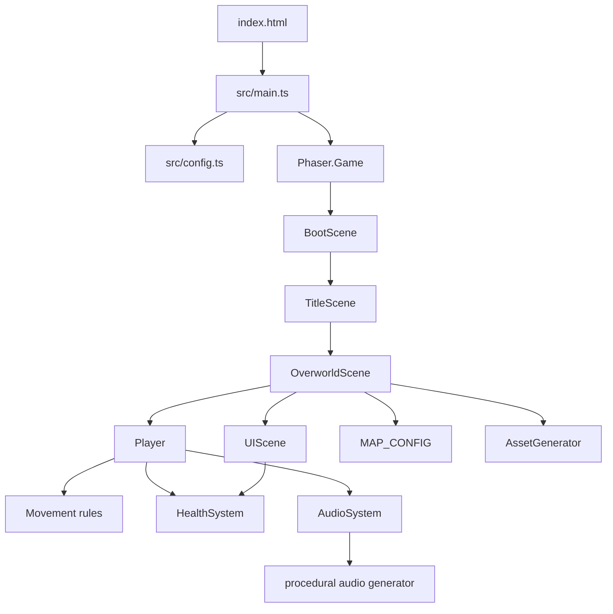
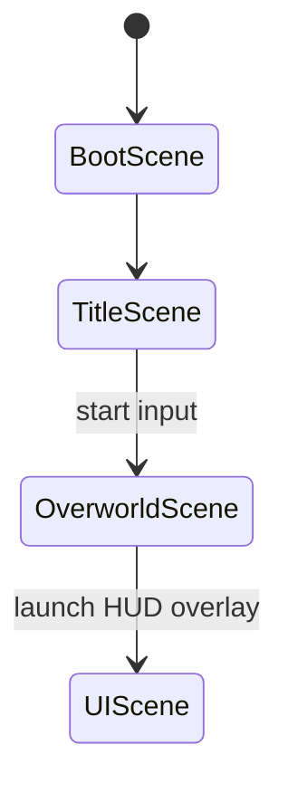
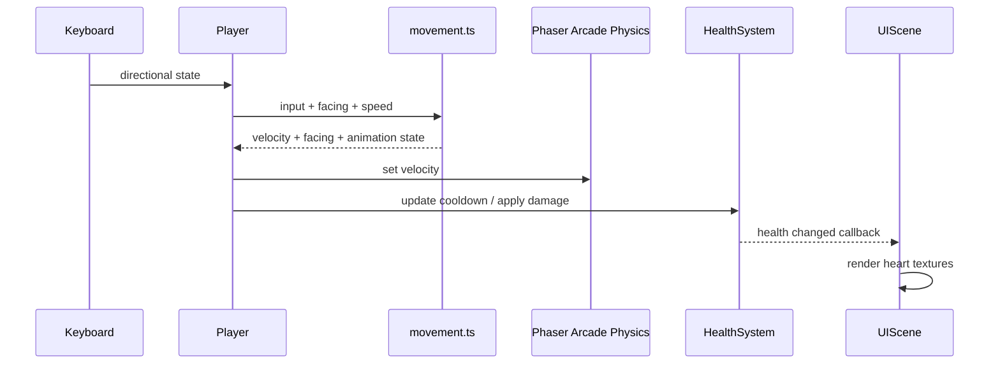
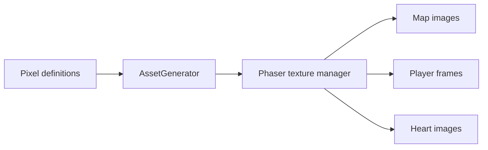

# Architecture

## Purpose

This project is a browser-hosted 2D adventure game built around Phaser 3, TypeScript, and Vite. The architecture keeps Phaser responsible for rendering, input, scene lifecycle, camera behavior, and arcade physics, while game rules that benefit from deterministic tests are isolated in small systems and pure utility modules.

The current implementation is intentionally compact: it provides a title flow, one playable overworld, a player character, health and invulnerability rules, a HUD, procedural textures, and procedural audio. The scene and system boundaries are designed to support later additions such as combat, enemies, dungeon rooms, persistence, and a victory flow without turning scene classes into a single global game controller.

## Runtime shape



The browser supplies the HTML container and starts the Vite module entry point. `main.ts` waits for the document to be ready, creates the Phaser configuration, registers the scene set, and constructs the game. From that point forward, Phaser drives the scene lifecycle and update loop.

## Application boundaries

### Browser and build boundary

`index.html` is the host shell. It defines the `#game-container`, global pixel-art presentation rules, and the module entry point. Vite compiles the TypeScript graph into static browser assets; it does not provide application services at runtime.

`config.ts` is the single place where the game’s display and physics defaults are assembled. It establishes the low-resolution logical canvas, pixel rendering behavior, scale mode, world-independent arcade physics defaults, and the scene registry supplied by the entry point.

Production deployment is static. `npm run build` type-checks and bundles the game into `dist/`, and Firebase Hosting serves that directory with a single-page rewrite. The hosting layer does not participate in gameplay.

### Scene boundary

Scenes are the composition and lifecycle layer. They create Phaser objects, connect systems to presentation, and decide when the player moves between game states.



- **`BootScene`** is the minimal transition scene. It establishes the initial scene flow and currently forwards immediately to the title screen.
- **`TitleScene`** owns title presentation and start input. It also triggers the game-start sound and performs the transition into the overworld.
- **`OverworldScene`** is the primary world composition root. It creates textures, configures world bounds, builds the map, instantiates the player, launches the HUD, registers collisions, and configures the camera.
- **`UIScene`** is a parallel screen-space presentation layer. It receives the player’s `HealthSystem` as scene data and renders health without owning or duplicating health state.

The scenes communicate through Phaser’s scene manager and explicit scene data rather than through a global game-state object. World-space gameplay remains in the overworld scene, while HUD objects use a fixed camera scroll factor so they remain attached to the viewport.

## Gameplay composition

### World and map

`MAP_CONFIG` defines the grid dimensions and tile size. `OverworldScene` translates that configuration into a world with grass, paths, environmental obstacles, a camera boundary, and a physics boundary.

The map currently uses procedural placement rules rather than a tilemap asset. Visual tiles are created by `AssetGenerator`, while solid environmental objects are inserted into a Phaser static physics group. This gives the world two coordinated layers:

1. **Presentation layer:** repeated Phaser images for terrain and scenery.
2. **Collision layer:** static bodies for trees, water, and stone walls.

That split allows visual composition to evolve independently from collision policy. A future dungeon or room system can reuse the same pattern while changing the map composition source.

### Player and input

`Player` is the gameplay adapter between Phaser and the game’s domain rules. It is a physics sprite, so it owns the Phaser-facing responsibilities:

- registering itself with the scene and arcade physics;
- configuring its collision body and world-bound behavior;
- reading keyboard state;
- selecting directional animations and idle frames;
- applying velocity;
- presenting damage feedback such as flashing, tinting, and camera effects.

Directional movement calculation is delegated to `entities/movement.ts`. That module accepts a plain input value and returns velocity, facing, and movement state. Because it has no Phaser dependency, diagonal normalization, opposite-input handling, and facing preservation can be tested independently.



### Health as a domain system

`HealthSystem` is the authoritative model for player health. It stores hit points, maximum heart containers, invulnerability time, and death state. It exposes commands such as damage, healing, and adding a heart container, and it exposes read methods for gameplay and presentation.

The system publishes two event-like callback streams:

- health changes, including the derived full/half/empty heart units;
- death notifications.

This keeps the HUD reactive without allowing it to mutate the model. The player owns the system instance because damage feedback and movement stopping are player behavior, while `UIScene` only observes it. The model’s time-dependent invulnerability is advanced from the player update loop, keeping it synchronized with the active gameplay entity.

### Audio boundary

`AudioSystem` is a process-wide service accessed through a singleton. Scene and entity code request named game sounds through semantic methods such as `playGameStart` or `playPlayerHurt`; they do not construct Web Audio nodes directly.

The system lazily initializes or resumes the browser audio context after user interaction, generates samples through `systems/audio/zzfx.ts`, caches completed buffers, and applies mute and master-volume policy before playback. This boundary isolates browser audio restrictions and procedural synthesis from gameplay code.

## Presentation and asset pipeline

The game currently has no runtime image asset dependency for its core art. `AssetGenerator` stores pixel definitions as palettes plus 16x16 character grids and materializes them as Phaser canvas textures when the overworld starts.



The generator is idempotent: scenes can request the texture set without recreating keys that already exist. This makes texture creation a scene concern while keeping the asset description reusable and testable.

Text rendering is centralized in `utils/text.ts`. Scenes choose between title and UI styles through shared factories, preserving the pixel-art typography and avoiding style construction scattered across scene code.

## Dependency direction

The intended dependency direction is from composition toward reusable rules:

```text
main/config
    -> scenes
        -> entities
        -> systems
        -> constants and utilities
entities
    -> systems and pure rules
systems
    -> types and low-level generators
pure rules/utilities
    -> shared types only
```

Scenes may compose systems and entities. Entities may use systems and pure rule modules. Pure modules should not depend on a scene, browser DOM, or Phaser unless their purpose is explicitly an engine adapter. The HUD may observe a system but should not become the owner of that system’s state.

Shared types in `types/game.ts` provide vocabulary for directions, positions, player statistics, and heart display units. Constants such as map dimensions stay separate from scene code so world sizing is not duplicated across camera, physics, and map construction.

## Update and event flow

Phaser owns the frame loop. `OverworldScene.update` delegates the active frame to `Player.update`, which advances health timers, handles test input, computes movement, and updates the sprite. Phaser then resolves collisions between the player and the overworld’s static obstacle group.

State changes flow outward through narrow interfaces:

- gameplay commands update a system;
- systems notify interested presentation or gameplay listeners;
- scenes and entities translate those changes into Phaser effects;
- Phaser renders the resulting object state.

This is deliberately not a full event bus. Direct references are used where ownership is clear, such as the overworld passing the player’s health model to the HUD. Named callbacks are used where a system needs to notify multiple consumers without exposing its internal state.

## Testing strategy

The repository’s tests focus on deterministic boundaries rather than Phaser rendering:

- movement tests validate directional resolution and normalized velocity;
- health tests validate heart arithmetic, damage rules, invulnerability, healing, and death;
- audio and utility tests validate procedural or formatting helpers;
- map, configuration, and asset tests validate stable data contracts.

Scene classes are integration points: they are best validated through type-checking, build validation, and focused browser-level checks when a behavior depends on Phaser’s runtime. Keeping movement and health logic independent of Phaser makes most gameplay rules testable without a canvas or browser.

## Extension seams

The current structure provides clear insertion points for the planned game expansion:

- **Combat:** add weapon actions and hit resolution around `Player`, with damage/knockback rules kept in a system rather than embedded in scene update code.
- **Enemies:** introduce entity classes that use shared movement, health, and collision contracts; the scene should compose them and own their groups.
- **Dungeon rooms:** add a room or dungeon scene that follows the overworld composition pattern and uses explicit scene transitions for room changes.
- **Progression and inventory:** extend the player’s domain state or introduce a dedicated progression model; pass read-only or event-driven state to HUD views.
- **Persistence:** add a save boundary around serializable domain state, keeping browser storage access out of entities and scenes.
- **Victory and game-over flows:** add scenes that consume domain outcomes instead of making the overworld responsible for all terminal presentation.

These extensions should preserve the central rule: Phaser-facing code coordinates the game, while reusable systems own rules and presentation observes state through explicit contracts.
