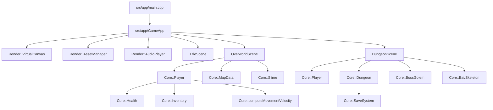
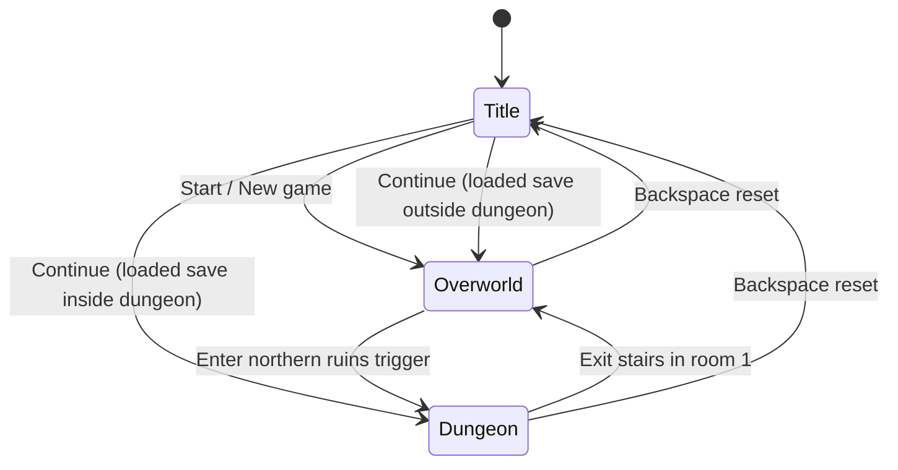

# Architecture

## Purpose

This project is a native C++20 retro action-adventure built on Raylib. The architecture separates:

- **application orchestration** (`src/app`) for scenes and game-state transitions;
- **gameplay/domain logic** (`src/core`) for movement, combat, health, dungeon rules, inventory, enemies, and save-state modeling;
- **render/audio adapters** (`src/render`) for texture generation, drawing, HUD, dialogue, virtual-canvas scaling, and sound playback.

The main goal is to keep gameplay logic deterministic and testable while isolating Raylib-specific concerns in thin rendering and runtime layers.

## Runtime shape



`main()` constructs `GameApp`, initializes window/audio/render services, then runs the frame loop. `GameApp` owns scene instances and routes `update()`/`render()` calls according to `Core::GameState`.

## Module boundaries

### `src/app` (scene composition and flow)

- **`GameApp`** owns application lifecycle, frame timing, and scene switching (`Title`, `Overworld`, `Dungeon`).
- **`TitleScene`** handles start/continue/new-game input and transition fade.
- **`OverworldScene`** composes the overworld map, player, slimes, item drops, shrine interaction, dungeon entry trigger, HUD/dialogue overlays, and camera follow.
- **`DungeonScene`** composes dungeon room progression, room transitions, chest/switch/plate interactions, arena locking, boss encounter, victory overlay, and return to overworld.

Scenes are integration roots: they orchestrate systems/entities and translate rules into input checks, sounds, and draw calls.

### `src/core` (domain and gameplay rules)

Core modules hold gameplay state and deterministic logic:

- **Math and shared types:** `types.hpp` (`Vec2`, `Rect`, `Direction`, `GameState`).
- **Player model and rules:** `Player`, `Movement`, `Combat`, `Shield`, `Projectile`.
- **World models:** `MapData` (overworld tiles/collision), `Dungeon` (room graph, doors, transitions, triggers).
- **Progression models:** `Health`, `Inventory`, `ItemDrop`, enemy models (`Slime`, `DungeonEnemies`, `BossGolem`).
- **Persistence:** `SaveSystem` and `SaveData` JSON serialization/deserialization and state capture/apply.
- **Audio synthesis:** `SoundGenerator` preset-based sample generation.
- **UI behavior helper:** `Typewriter` incremental dialogue reveal.

### `src/render` (Raylib adapters and presentation)

- **`VirtualCanvas`** renders the game to a fixed 320×240 target and scales to the actual window.
- **`AssetManager`** loads procedurally generated sprite definitions into Raylib textures and can export PNGs.
- **`MapRenderer`** draws visible overworld tile layers using camera bounds.
- **`UIRenderer`** draws hearts, inventory, boss bar, game-over, and victory overlays.
- **`DialogueBox`** draws framed dialogue UI and uses `Core::Typewriter`.
- **`AudioPlayer`** converts generated PCM samples into Raylib `Sound` objects and exposes semantic play methods.

## Scene/state flow



`GameApp` is the only owner of top-level state transitions. Scene-to-scene data transfer happens through explicit calls (e.g., passing player state into `enterDungeon` / `returnFromDungeon`) and `SaveSystem`.

## Data and update flow

Per frame:

1. Scene reads keyboard input.
2. Scene delegates movement/combat updates to `Core` entities and systems.
3. Core models update timers, collision outcomes, and progression flags.
4. Scene triggers side effects (audio, dialogue, transitions, save checkpoints).
5. Scene renders world-space pass (camera) then screen-space HUD/overlays.
6. `VirtualCanvas` draws the scaled final frame to the window.

This keeps mutation localized in scene roots and core models while rendering modules remain mostly stateless adapters.

## Persistence model

`SaveSystem` serializes `SaveData` to `savegame.json` and supports:

- title-screen continue detection;
- checkpoint saves during key progression events (e.g., sword pickup, chest/switch progress, arena clear, boss clear);
- restoration of player state, dungeon room state, and progression flags.

Persistence is explicit and scene-triggered; there is no background autosave service.

## Dependency direction

```text
main
  -> app (GameApp + scenes)
      -> core (gameplay/domain rules)
      -> render (Raylib adapters)
render
  -> core (read-only domain data for presentation)
core
  -> core/types and standard library only
```

Rules:

- `core` must stay independent from Raylib rendering APIs where possible.
- `app` may compose both `core` and `render`.
- `render` should present state, not own gameplay rules.
- cross-scene transitions occur through `GameApp`, not direct scene coupling.

## Build and test boundary

- **Build/runtime:** `Makefile` compiles C++20 sources, statically links vendored Raylib, and emits `bin/zelda_game`.
- **Tests:** `make test` builds `bin/test_runner` from `tests/test_runner.cpp` plus selected core/render units.
- **Test focus:** deterministic logic (math, movement, map collision, health, combat, inventory, dungeon progression, boss behavior, save serialization, generated assets/sounds).

The architecture favors testable core logic and thin platform adapters so gameplay evolution can continue without entangling scene orchestration and low-level rendering/audio details.
